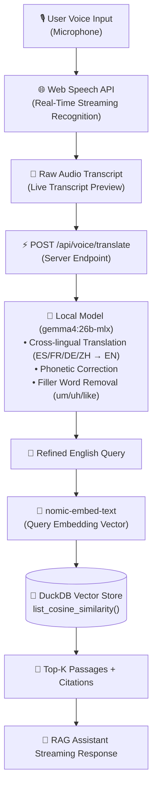
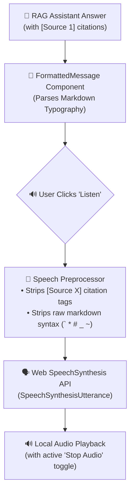

# 🧠 Knowledge Bank

> A private, local-first Knowledge Bank built with **React 19**, **TypeScript**, embedded **DuckDB** vector store, and local **Ollama** models for fast semantic search and conversational RAG.

---

## 🌟 Key Features

- **Embedded DuckDB Vector Store**:
  - Uses DuckDB's native `FLOAT[]` vector representation and high-performance `list_cosine_similarity` analytical queries.
  - Zero cloud dependencies, zero external database setup—everything lives in `./data/knowledge_bank.duckdb`.
- **Intelligent Ingestion Engine**:
  - **CSV Batch Import & Automatic Feed Deciphering**: Import dozens of sources at once by uploading `.csv`/`.txt` files or pasting raw lines. The engine automatically probes each URL to decipher whether it is an RSS/Atom feed or a web article URL without requiring manual tagging.
  - **URL Scraper**: Uses `@mozilla/readability` and `jsdom` (Firefox Reader Mode engine) to strip web clutter (ads, sidebars, navigation) into clean text.
  - **Manual Text / HTML Fallback**: If an automated URL fetch fails (due to paywalls, Cloudflare bot protection, 403s, or network timeouts), the app prompts the user with an interactive modal to directly paste article text, markdown, or webpage HTML for instant DuckDB indexing.
  - **RSS / Atom Feeds**: Automatically polls feeds (e.g. Hacker News, Substack, ArXiv, TechCrunch) and indexes new articles.
  - **Sliding-Window Chunker**: Splits text with sentence-boundary awareness and configurable overlap (~1500 chars / 250 overlap).
  - **Deduplication**: SHA-256 content hashing prevents redundant scraping or re-embedding.
- **Local Ollama AI Integration**:
  - Automatically discovers installed Ollama models (`nomic-embed-text`, `mxbai-embed-large`, `gemma4:26b-mlx`, `llama3.2`, `mistral`, `qwen2.5`, etc.).
  - Real-time connection health checks and custom model selector.
- **Fast Semantic Search**:
  - Real-time vector search with configurable **Top-K** and **Minimum Similarity** threshold sliders.
  - Filter by specific knowledge sources or search across the entire library.
- **Conversational RAG Assistant & Voice Mode**:
  - **Live Voice Input**: Real-time microphone capture with animated sound waves and speech recognition.
  - **Local Model Audio Translation**: Automatically routes spoken speech through your local Ollama model to translate from other languages (Spanish, French, German, Chinese, etc.), remove conversational filler words, and format into crisp research queries.
  - Multi-turn chat assistant grounded strictly in your saved articles.
  - Real-time token streaming via Server-Sent Events (SSE).
  - Expandable citation cards with direct links and chunk previews.
  - **Text-to-Speech (TTS)**: Listen to the assistant read answers aloud with a single click.
- **Document Library & Reader Mode**:
  - Clean article reading view with metadata (author, publication date, source).
  - Low-level vector chunk inspector with token counts and chunk indexing.

---

## 🏗️ Architecture

```
knowledge-bank/
├── client/                    # React 19 + TypeScript + Vite + Tailwind CSS
│   ├── src/
│   │   ├── api/client.ts      # Type-safe API client & SSE streaming reader
│   │   ├── components/        # UI components (Navbar, Sidebar, Modals)
│   │   │   ├── chat/          # RAG ChatInterface, VoiceRecorder, CitationCard, FormattedMessage
│   │   │   ├── documents/     # DocumentLibrary & filters
│   │   │   ├── search/        # SemanticSearch & SearchResultCard
│   │   │   └── sources/       # SourceList, AddSourceModal, DocumentReader
│   │   └── App.tsx            # Main application layout
├── server/                    # Node.js + TypeScript + Express backend
│   └── src/
│       ├── db/
│       │   ├── duckdb.ts      # @duckdb/node-api client & vector similarity queries
│       │   └── schema.ts      # DDL schemas for sources, documents, and chunks
│       ├── services/
│       │   ├── scraper.ts     # Mozilla Readability + JSDOM web extractor
│       │   ├── rss.ts         # RSS parser & background sync worker
│       │   ├── chunker.ts     # Sliding window text chunking
│       │   ├── ollama.ts      # Ollama embedding & chat streaming client
│       │   ├── voice.ts       # Audio translation & query refinement service
│       │   └── rag.ts         # Top-K vector retrieval & prompt assembly
│       └── routes/            # REST API & SSE streaming endpoints (sources, docs, search, chat, voice, models, stats)
├── shared/
│   └── types.ts               # Shared TypeScript models (Source, Document, Chunk, etc.)
└── data/
    └── knowledge_bank.duckdb  # Local embedded DuckDB database file
```

---

## 🤖 Models Used

| Role | Model | Specs & Purpose |
| :--- | :--- | :--- |
| **Vector Embeddings** | **`nomic-embed-text`** | • **768 dimensions**, 8192 token context window.<br>• Generates dense semantic vector embeddings for article chunks and search queries.<br>• Indexed directly into DuckDB's `FLOAT[]` columnar storage. |
| **Reasoning, RAG & Audio Translation** | **`gemma4:26b-mlx`** | • **26B parameters**, optimized for Apple Silicon (MLX).<br>• Synthesizes multi-turn RAG answers grounded strictly in DuckDB documents.<br>• Powers **Speech-to-Text (STT) translation & refinement**: converts multi-lingual spoken transcripts into crisp English search queries. |
| *Alternative Chat Models* | `llama3.2`, `mistral`, `qwen2.5` | Fully compatible; dynamically selectable in the **Ollama Configuration** modal. |
| *Alternative Embeddings* | `mxbai-embed-large`, `all-minilm` | Supported by the embedded DuckDB vector schema. |

---

## 🎙️ Voice Modalities: STT & TTS Pipeline Flow

The **Research Assistant** features a complete bi-directional voice pipeline for hands-free knowledge discovery:

### 1. Speech-to-Text (STT) & Translation Path

Translates multi-lingual spoken voice into polished, searchable queries using the local model:



#### Step-by-Step STT Breakdown:
1. **Audio Capture**: The user clicks **Voice** in the RAG Assistant. An animated sound wave visualizer and timer activate while audio is captured.
2. **Streaming Speech Recognition**: Client-side `SpeechRecognition` / `webkitSpeechRecognition` captures phonemes and produces real-time interim transcripts.
3. **Local LLM Audio Refinement & Translation**:
   - The raw transcript is sent to `POST /api/voice/translate`.
   - The local model (`gemma4:26b-mlx`) translates foreign languages into English, removes filler words (*"um"*, *"uh"*, *"like"*), and reformulates spoken thoughts into a crisp, searchable research query.
4. **Vector Retrieval & RAG**: The refined query is embedded via `nomic-embed-text`, matched against DuckDB vector chunks via `list_cosine_similarity()`, and passed to the RAG synthesis engine.

---

### 2. Text-to-Speech (TTS) Voice Playback Path

Converts synthesized answers into spoken audio for hands-free listening:



#### Step-by-Step TTS Breakdown:
1. **Response Generation**: The assistant outputs markdown-formatted text with bracketed citations like `[Source 1]`.
2. **Text Normalization**: When the user clicks **Listen**, the speech preprocessor strips bracketed citations and formatting symbols to prevent awkward phonetic pauses.
3. **Local Speech Synthesis**: The browser's native `window.speechSynthesis` speaks the answer aloud at a natural cadence with one-click **Stop Audio** controls.

---

## 🚀 Quickstart Guide

### 1. Prerequisites

- **Node.js**: v20+ (tested on Node 20, 22, and 26)
- **Ollama**: Installed and running locally ([Download Ollama](https://ollama.ai))

Pull recommended local models for embeddings and chat:

```bash
# Recommended 768-dim embedding model
ollama pull nomic-embed-text

# Recommended chat LLM
ollama pull gemma4:26b-mlx
```

### 2. Installation

```bash
# Clone or navigate to the workspace
cd knowledge-bank

# Dependencies are already installed, or run:
npm install
```

### 3. Start Development Server

Run both the Vite frontend and the Express backend concurrently:

```bash
npm run dev
```

- **Frontend App**: `http://localhost:5005`
- **Backend API**: `http://localhost:5004`

### 4. Build for Production

```bash
npm run build
npm start
```

---

## 💡 How to Use

1. **Add Sources**:
   - Open the **Sources & Feeds** tab.
   - Click **Add Source** and paste any webpage URL or RSS/Atom feed URL (e.g. `https://news.ycombinator.com/rss`).
   - The engine automatically parses the feed, strips HTML clutter, chunks the text, and stores vector embeddings in DuckDB.
2. **Perform Semantic Vector Search**:
   - Navigate to **Semantic Search**.
   - Type any conceptual question or phrase (e.g., *"vector database benchmarks"* or *"large language model updates"*).
   - Adjust the **Top-K** and **Min Similarity** sliders to inspect matching chunks with similarity percentages.
3. **Chat with Your Knowledge Base (RAG)**:
   - Go to **RAG Assistant**.
   - Ask questions about your saved articles. The assistant retrieves relevant passages from DuckDB, includes clickable citations, and streams the answer using your local Ollama LLM.
4. **Inspect Documents**:
   - Click **Document Library** or **Browse** on any source to read the clean article text and view all generated vector chunks.

---

## 🔒 Privacy & Local Execution

- All web content, embeddings, and chat interactions remain **100% on your local machine**.
- The DuckDB database resides in `./data/knowledge_bank.duckdb`.
- No third-party API keys or cloud vector databases are required.
